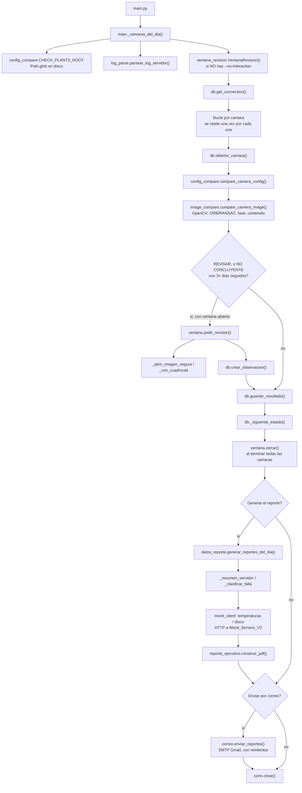
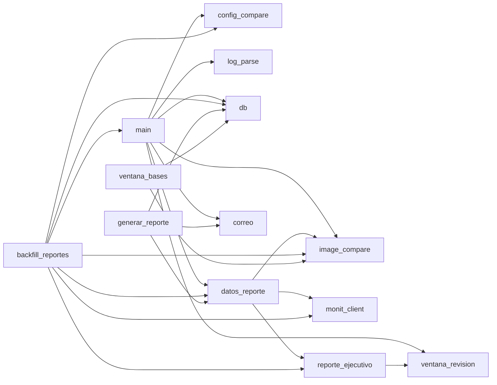

# Flujo de ejecución — `main.py` (corrida diaria)

> Primer diagrama de la carpeta `diagramas/`. Cubre únicamente la corrida normal de `main.py` -- el
> programa principal que se corre todos los días -- tal como está hoy (lo que en la conversación
> llamamos "Versión 1"). Los demás puntos de entrada (`generar_reporte.py`, `ventana_bases.py`,
> `backfill_reportes.py`, scripts de administración) se listan al final y quedarán en diagramas
> propios más adelante.

## 1. Orden de ejecución, paso a paso

1. **`main.py` arranca.**
   - Parsea argumentos (`argparse`): `--client`, `--date`, `--no-interaction`, `-h`.
   - Pide la fecha por consola si no se dio `--date`.

2. **`main._camaras_del_dia(date_str, cliente)`** -- construye la lista de cámaras a procesar.
   - Usa `config_compare.CHECK_PLANTS_ROOT` (variable de entorno) como raíz.
   - Recorre el sistema de archivos (`Path.glob`) buscando `.json` y `.jpg` bajo
     `CHECK_PLANTS_ROOT/[Cliente]/[Mes]/[ddmmyy]/[Planta]/[Servidor]/`.
   - Por cada `.log` de servidor encontrado, llama a **`log_parse.parsear_log_servidor()`** --
     regresa, por cámara, si el programa externo de revisión la capturó ese día y por qué no si
     falló.
   - Junta archivos + log en una sola lista ordenada -- una cámara que falló por completo (sin
     `.jpg` ni `.json`) igual aparece aquí gracias al `.log`.

3. **`ventana_revision.VentanaRevision()`** (solo si NO hay `--no-interaction`) -- abre la ventana
   Tkinter. Queda viva durante toda la corrida.

4. **`db.get_connection()`** -- abre la conexión a Postgres. Se mantiene abierta toda la corrida.

5. **Bucle por cámara** (una a la vez, en orden cliente → planta → servidor → cámara):
   1. `ventana.mostrar_procesando(...)` -- actualiza la barra de progreso (si hay ventana).
   2. **`db.obtener_camara(conn, ...)`** -- upsert + lee el perfil vivo de esa cámara
      (`estado_actual`, `dias_no_concluyente_consecutivos`) desde `perfil_camara`.
   3. Si hay `.json`: **`config_compare.compare_camera_config(...)`**
      - Detecta la marca (`detect_brand`) y compara contra la base en `CONFIG_BASE_ROOT`
        (`load_base` / `save_base` / `compare`), por campos curados según la marca (4 marcas
        soportadas: AXIS, HIKVISION, VIVOTEK, DAHUA).
   4. Si hay `.jpg`: **`image_compare.compare_camera_image(...)`**
      - Carga la base desde `IMAGE_BASE_ROOT` (`load_base` / `save_base`).
      - Si la cámara está marcada `base_desactualizada`, no compara nada (regresa directo
        `"BASE DESACTUALIZADA"`).
      - Si no, corre `evaluar_par()`: ORB+RANSAC, correlación de fase, diferencia de contenido
        (OpenCV) → `OK` / `REVISAR` / `NO CONCLUYENTE` / `RESOLUCION DISTINTA`.
   5. **¿Hace falta un humano?** Si el resultado es `REVISAR`, o es `NO CONCLUYENTE` y ya van 3 días
      seguidos (`db.DIAS_AMARILLO_PARA_REVISION`), y hay ventana abierta, y la cámara no está ya
      confirmada en rojo:
      - **`ventana.pedir_revision(...)`** -- bloquea hasta que un humano responda (Bien / Mal / Base
        Desactualizada + observación opcional).
        - Carga las imágenes con **`ventana_revision._abrir_imagen_segura()`** +
          **`_con_cuadricula()`** (base y actual, con cuadrícula guía).
        - Si se escribió una observación: **`db.crear_observacion(conn, ...)`**.
   6. **`db.guardar_resultado(conn, ...)`** -- calcula el nuevo estado con
      **`db._siguiente_estado(...)`** y hace upsert en `historial_comparacion` + actualiza el
      semáforo vivo en `perfil_camara`.
   7. Imprime una línea de resumen en consola.

6. **Fin del bucle**: si hay ventana, muestra "Corrida completa" y la cierra (`ventana.cerrar()`).

7. **Pregunta (o automático con `--no-interaction`): "¿Generar el reporte ejecutivo?"**
   Si sí: **`datos_reporte.generar_reportes_del_dia(conn, fecha, cliente)`**
   1. Resuelve el cliente sin importar mayúsculas (`_resolver_cliente`) o lista todos los del día
      (`_clientes_del_dia`).
   2. Por cada cliente, por cada servidor (`_servidores_del_cliente`): **`_resumen_servidor(...)`**
      - Lee `historial_comparacion` + `perfil_camara` de ese servidor/fecha.
      - Clasifica fallas por cámara (**`_clasificar_falla`**): sin respuesta (según el `.log`),
        rojo, morado, base desactualizada; cuenta aparte el ámbar de 1-2 días (columna "No
        concluyente").
      - Pide temperatura y disco a **`monit_client.temperaturas_promedio_dia()`** /
        **`monit_client.uso_disco_actual()`** -- llamadas HTTP a la API de `Monit_Servers_V2`
        (`http://develop:8000`, proyecto hermano). Si no responde, sigue sin esos datos (no
        bloquea el reporte).
   3. **`reporte_ejecutivo.construir_pdf(...)`** -- arma las tablas (ReportLab), reutiliza
      `ventana_revision._con_cuadricula()` / `_abrir_imagen_segura()` para las imágenes, escribe el
      PDF en `REPORTES_ROOT/[Cliente]/[DDMMYYYY]_[Cliente].pdf`.

8. **Si se generó algún reporte, pregunta (o automático): "¿Enviar por correo?"**
   Si sí: **`correo.enviar_reportes(rutas_generadas)`**
   1. Por cliente: resuelve destinatarios de `.env` (`_destinatarios`, respeta el valor especial
      `NINGUNO` para no enviarle nada a un cliente a propósito).
   2. Arma el mensaje (`_construir_mensaje`, firma HTML con logo embebido vía `Content-ID`) y lo
      envía por SMTP con reintentos (`_enviar_con_reintentos`, 2 reintentos, 5s de espera).

9. **`conn.close()`** -- fin del programa.

## 2. Diagrama (orden de llamadas)

*(El rombo "Bucle por cámara" se procesa cámara por cámara, en orden cliente → planta → servidor →
cámara -- se omitió la flecha de vuelta explícita en el diagrama para que se mantenga legible; ver
la sección 1 para el detalle secuencial.)*

## 3. Mapa de módulos (quién importa a quién)

## 4. Sistemas externos con los que habla el programa en una sola corrida

- **Sistema de archivos**, 3 raíces distintas vía `.env`: `CHECK_PLANTS_ROOT` (lectura),
  `CONFIG_BASE_ROOT` y `IMAGE_BASE_ROOT` (lectura + escritura).
- **PostgreSQL** (`db.py`): una sola conexión abierta durante toda la corrida.
- **API HTTP de `Monit_Servers_V2`** (`monit_client.py`, proyecto hermano, solo si se genera el
  reporte).
- **SMTP de Gmail** (`correo.py`, solo si se envía correo).
- **Tkinter** (`ventana_revision.py`): una ventana con su propio bucle de eventos, que bloquea el
  hilo principal del programa cada vez que pide revisión humana.

## 5. Otros puntos de entrada (no cubiertos aquí -- diagramas propios más adelante)

- `generar_reporte.py` -- reusa los pasos 7-9 de arriba, sin pasar por el bucle de comparación
  (parte directo de lo que ya esté guardado en la base de datos).
- `ventana_bases.py` -- ventana aparte para reemplazar bases de imagen marcadas como
  desactualizadas.
- `backfill_reportes.py` -- repite los pasos 2 y 5.3-5.4 sobre un rango de fechas, pero todo en
  memoria (sin `db.py`, sin ventana, sin correo).
- `migrate.py`, `bootstrap_config_base.py`, `bootstrap_image_base.py`, `diagnostico_jpeg.py` --
  scripts puntuales de administración, no son parte de la corrida diaria.
