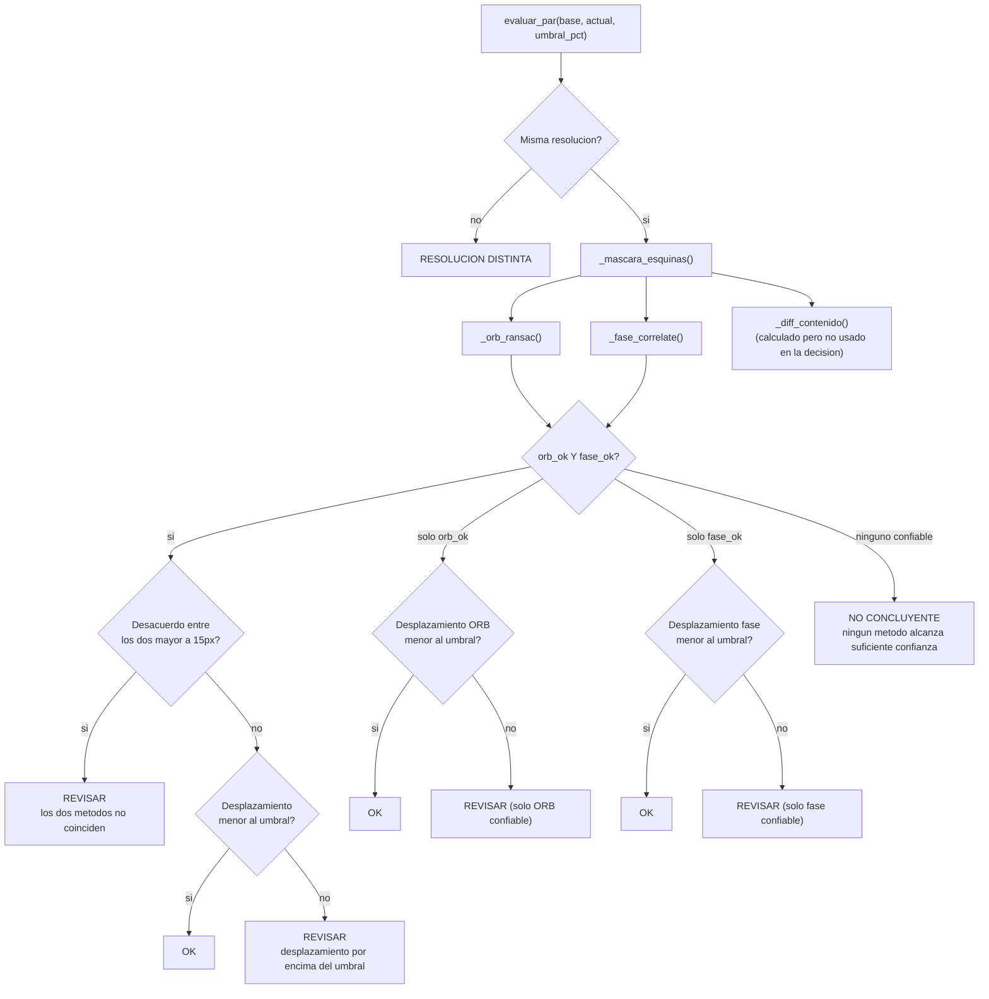
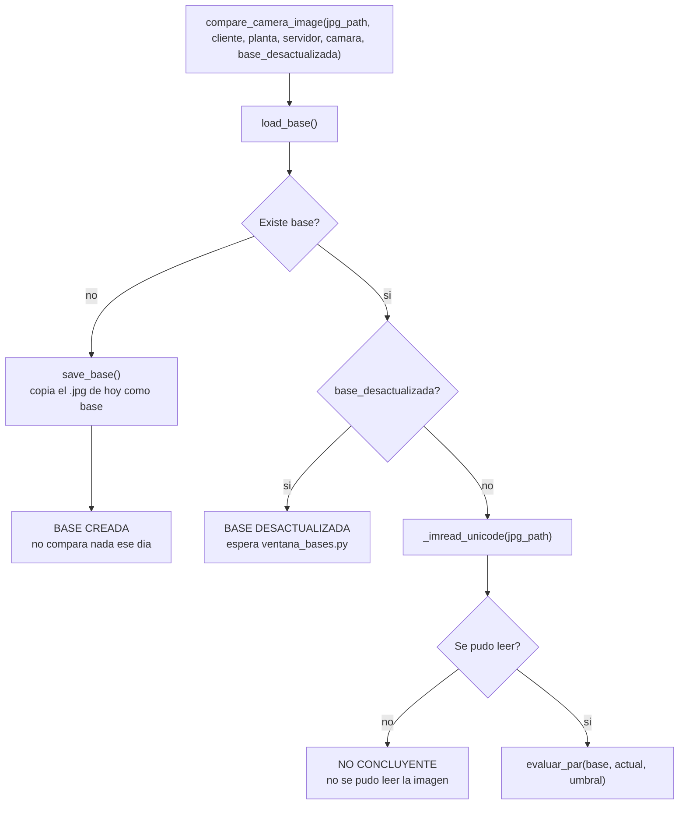

# Módulo: `comparacion/image_compare.py`

> Decide si una cámara se movió, quedó obstruida, o sigue igual, comparando su foto de hoy contra
> una imagen "base" de referencia guardada en disco. Es la Fase 2 del proyecto -- ver ROADMAP.md,
> Experimentos 1-9, para la evidencia detrás de cada decisión de diseño que aparece aquí.

## 1. Idea central

Ni la geometría (¿sigue apuntando al mismo lugar?) ni el contenido (¿sigue viendo lo mismo?) solos
bastan, y **nunca se usan en cascada** ("si falla A, pruebo B"). Los Experimentos 1-9 mostraron que
los dos métodos geométricos pueden equivocarse de la misma forma al mismo tiempo (ej. ante un patrón
repetitivo, Experimento 7) -- así que se corren siempre los dos, y su desacuerdo entre sí ya es una
señal de alerta por sí sola.

## 2. Paso 0 -- taparse los ojos del texto sobreimpreso

Antes de medir nada, `_mascara_esquinas()` tapa dos zonas fijas de ambas imágenes:

- Esquina superior-izquierda (`_FRAC_ANCHO_ESQUINA = 0.35` del ancho, `_FRAC_ALTO_ESQUINA = 0.12`
  del alto): fecha/hora sobreimpresa por la cámara.
- Esquina inferior-derecha, mismo tamaño: nombre de la cámara.

**Por qué (Experimento 4)**: ese texto está fijo en coordenadas del sensor -- no se mueve aunque la
cámara gire físicamente. Sin taparlo, puede "secuestrar" la medición con alta confianza y producir
un falso negativo (la cámara sí se movió, pero el texto fijo hace parecer que no).

## 3. Las dos señales de geometría (siempre se corren ambas)

### Método A -- ORB + RANSAC (`_orb_ransac`)

1. Detecta hasta 4000 puntos de interés (`_ORB_NFEATURES`) por imagen -- esquinas, texturas,
   bordes.
2. Empareja los puntos de la base con los de la imagen actual (`BFMatcher`, filtro de Lowe al
   75%).
3. Le pide a `cv2.findHomography` con RANSAC que encuentre una transformación geométrica
   consistente, descartando los puntos que no encajan ("outliers").
4. Si quedan **menos de 100 inliers** (`MIN_INLIERS`), no es confiable -- `orb_ok = False`.
5. Si es confiable, el desplazamiento reportado es el promedio de distancia entre los puntos
   inlier emparejados.

### Método B -- Correlación de fase (`_fase_correlate`)

Técnica de procesamiento de señales (`cv2.phaseCorrelate`) que encuentra el desplazamiento
`(dx, dy)` que mejor alinea las dos imágenes **completas** (no puntos sueltos), con un valor de
confianza de 0 a 1. Si la confianza es **menor a 0.15** (`MIN_CONF_FASE`), no es confiable --
`fase_ok = False`.

### Señal secundaria -- diferencia de contenido (`_diff_contenido`)

Difumina ambas imágenes (`GaussianBlur`) y calcula la diferencia de píxeles absoluta (`cv2.absdiff`
+ media y percentil 95). Pensada para detectar obstrucción total, donde la geometría ya no tiene
ningún punto fijo que medir (ej. una caja tapando todo el lente).

> ⚠️ **Hallazgo (26/10/2026)**: `contenido_mean`/`contenido_p95` se calculan en **cada**
> comparación, pero no se usan en ningún lado más allá de `evaluar_par()` -- no entran en la
> decisión de `OK`/`REVISAR`/`NO CONCLUYENTE`, no se muestran en la ventana de revisión
> (`main._formatear_diagnostico` solo arma texto con ORB y fase), y no se guardan en la base de
> datos (`historial_comparacion` no tiene columnas para esto, confirmado revisando
> `persistencia/db.py`). Hoy es trabajo de CPU real sin ningún efecto observable.

## 4. La decisión (`evaluar_par`)

**Umbral de movimiento** (`umbral_para`, hoy fijo en `UMBRAL_MOVIMIENTO_PCT = 0.25`% del ancho de
la imagen para todas las cámaras): el Experimento 8 midió que la misma rotación física produce
~10x más píxeles de desplazamiento en una escena cercana que en una lejana -- un umbral único no le
sirve igual de bien a todas. Está marcado como punto de enganche para que algún día lea un umbral
por cámara desde `perfil_camara`, pero **todavía no se implementó** (sigue regresando la constante
global).

## 5. Orquestación por cámara (`compare_camera_image`)

`base_desactualizada` no es un archivo marcador en disco -- viene de
`perfil_camara.estado_actual` en la base de datos; quien llama a esta función (`main.py`) decide
si pasarlo en `True` antes de pedir la comparación. Este módulo ya no sabe nada de archivos
marcadores (diseño viejo, reemplazado en la Fase 3).

`_imread_unicode` existe porque `cv2.imread` no soporta rutas con acentos en Windows (usa la API
ANSI) -- se lee el archivo a bytes primero y se decodifica con `cv2.imdecode`.

## 6. Estados posibles que regresa este módulo

| `status` | Cuándo | Qué hace `main.py` con esto |
| --- | --- | --- |
| `BASE CREADA` | Primera vez que se ve esta cámara, no había base. | Se trata igual que `OK` (pasa a verde). |
| `OK` | Los métodos confiables coinciden en que no hubo desplazamiento significativo. | Pasa a verde. |
| `REVISAR` | Desplazamiento por encima del umbral, o los dos métodos no coinciden entre sí. | Pasa a morado; si hay ventana abierta, pide revisión humana. |
| `NO CONCLUYENTE` | Ningún método (ORB ni fase) alcanza suficiente confianza para opinar. | Pasa a ámbar; al 3er día seguido escala a morado y fuerza revisión (ver ROADMAP, 22/10/2026). |
| `RESOLUCION DISTINTA` | La imagen de hoy tiene un tamaño distinto al de la base. | No se compara nada -- el estado se queda como estaba el día anterior (`db._siguiente_estado` no reconoce este status). |
| `BASE DESACTUALIZADA` | La cámara está marcada así en `perfil_camara`. | No se compara nada -- se queda en ese estado hasta que alguien reemplace la base con `ui/ventana_bases.py`. |

## 7. Constantes y umbrales (todos en este archivo)

| Constante | Valor | Origen |
| --- | --- | --- |
| `MIN_INLIERS` | 100 | Experimentos 3, 5, 6, 7b, 9 |
| `MIN_CONF_FASE` | 0.15 | Experimento 9 -- marcado como "pendiente de recalibrar" en el propio código |
| `UMBRAL_DESACUERDO_PX` | 15.0 px | Qué tan distintos pueden ser ORB y fase antes de considerarlo sospechoso |
| `UMBRAL_MOVIMIENTO_PCT` | 0.25% del ancho | Umbral de movimiento global -- no varía por cámara todavía |
| `_FRAC_ANCHO_ESQUINA` / `_FRAC_ALTO_ESQUINA` | 0.35 / 0.12 | Tamaño de las zonas tapadas (texto sobreimpreso) |
| `_ORB_NFEATURES` | 4000 | Cuántos puntos de interés detecta ORB por imagen |

## 8. Lo que este módulo NO hace

- No decide si hace falta un humano -- solo regresa un `status`. Esa decisión (abrir la ventana,
  forzar revisión al 3er día ámbar, etc.) vive en `main.py`.
- No persiste nada en base de datos -- eso lo hace `persistencia/db.py` después, con lo que este
  módulo regresó.
- No sabe nada de clientes/servidores más allá de usarlos para construir la ruta del archivo base.
- No usa el resultado de `_diff_contenido` para nada (ver el hallazgo de la sección 3).
