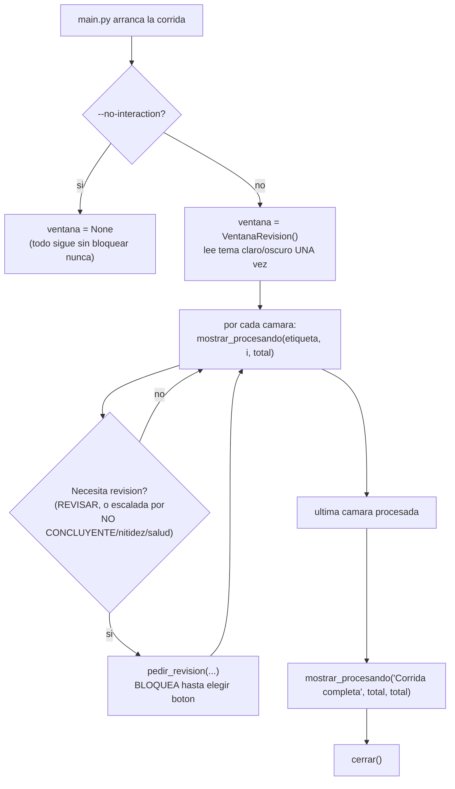
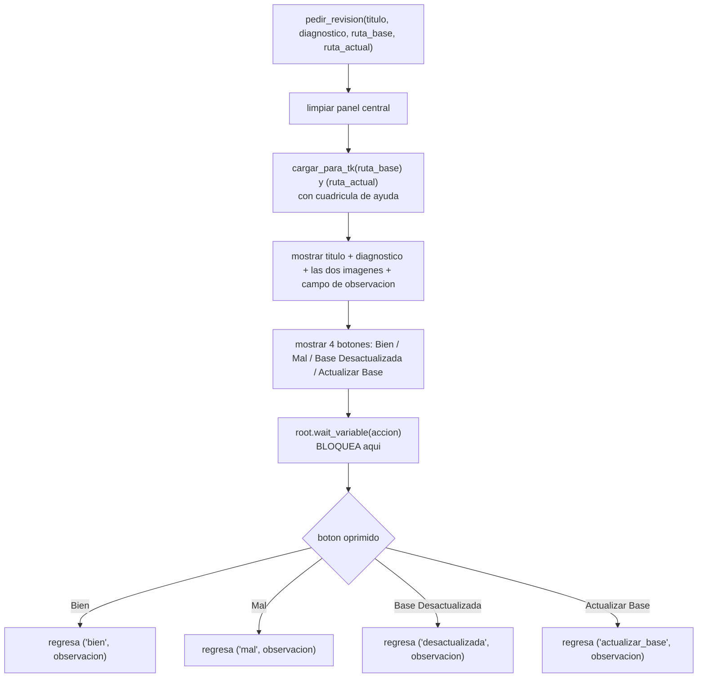

# Módulo: `ui/ventana_revision.py`

> La ventana que un humano ve durante la corrida de `main.py`: normalmente muestra progreso, y
> cuando una cámara necesita revisión, se convierte en un panel de comparación (base vs. actual +
> diagnóstico + 4 botones) que bloquea hasta que alguien decide. Este módulo no decide nada por su
> cuenta -- `main.py` es quien decide cuándo mostrar cada cosa (ver `diagramas/01-flujo-main.md`).

## 1. Idea central

Una sola ventana persistente, abierta desde que arranca la corrida hasta que termina -- no se abre
y cierra una por cámara. Tiene exactamente dos "caras":

- **Procesando** (no bloquea): barra de progreso + nombre de la cámara actual. `main.py` la llama
  entre cámara y cámara, sin esperar nada.
- **Pedir revisión** (sí bloquea): comparación lado a lado (Base / Actual) + diagnóstico de texto +
  4 botones. `main.py` la llama solo cuando una cámara necesita que un humano decida, y la corrida
  se detiene ahí hasta que se oprime un botón.

Un solo hilo, sin threads ni async: el bloqueo de "pedir revisión" se logra con
`root.wait_variable()`, que deja correr el bucle de eventos de Tkinter (la ventana sigue
respondiendo, se puede mover/redimensionar) pero no regresa el control a `main.py` hasta que algún
botón cambia esa variable.

## 2. Ciclo de vida por corrida

`main.py` es quien decide **cuándo** llamar a `pedir_revision()` -- este módulo no sabe nada de
`REVISAR`/`NO CONCLUYENTE`/nitidez/salud ni de umbrales. Solo sabe mostrar lo que le piden y
regresar qué botón se oprimió.

## 3. Los dos paneles

### Procesando (`mostrar_procesando`)

Reemplaza todo el contenido central por un texto "Procesando…" + el nombre de la cámara, y
actualiza la barra de progreso (hecha a mano con `Frame`s, no `ttk.Progressbar` -- en Windows
`ttk` a veces ignora colores personalizados y dibuja con el tema nativo, una barra casi invisible
sobre fondo oscuro). Termina con `root.update()` para forzar el repintado antes de seguir -- no
hay bucle de eventos propio aquí, solo un refresco puntual.

### Pedir revisión (`pedir_revision`)

Cada botón solo hace `self._accion.set(...)` -- es ese cambio de valor el que libera el
`wait_variable` de la línea de arriba y deja que la función siga y regrese.

## 4. Detalles de implementación que vale la pena conocer

- **Tema oscuro/claro automático**: `_tema_oscuro_del_sistema()` lee el registro de Windows
  (`Personalize\AppsUseLightTheme`) **una sola vez**, al abrir la ventana -- no hay botón para
  cambiarlo a mitad de la corrida (decisión explícita, ver docstring del módulo). La barra de
  título también se pinta oscura a mano vía `DwmSetWindowAttribute` (Windows no lo hace solo); si
  falla (otro SO, Windows viejo), se ignora sin romper nada.
- **Cuadrícula de ayuda visual** (`_con_cuadricula`): dibuja líneas guía delgadas sobre una
  *copia en memoria* de la imagen que se muestra en pantalla -- nunca toca el `.jpg` original en
  disco. Celdas cuadradas (el ancho se divide en 10 partes iguales, el alto usa ese mismo tamaño
  de celda) para no deformar la proporción real de la imagen al juzgar a ojo si algo se movió.
- **Imágenes dañadas no tumban la ventana** (`_abrir_imagen_segura` + `_imagen_marcador`): Pillow
  es más estricto que OpenCV para decodificar JPG -- un archivo que `comparacion/image_compare.py`
  pudo leer para comparar puede reventar aquí al mostrarlo. Si eso pasa, se muestra un recuadro
  gris con el texto "Imagen no disponible (archivo dañado)" en su lugar, en vez de crashear toda
  la corrida justo al pedirle a alguien que revise esa cámara (bug real, 26/10/2026 -- ver
  ROADMAP.md).
- **Un solo campo de captura humana**: el cuadro de observación (opcional) es, hoy, la única forma
  de dejar una nota de contexto ligada a una cámara -- y solo existe en este momento preciso
  (cuando se pide revisión). Una cámara que ya está en rojo o en ámbar no pasa por aquí, así que no
  tiene manera de recibir una observación nueva hasta que vuelva a necesitar revisión (ROADMAP.md,
  "Observaciones por cámara") -- se resolverá en el programa de administración aparte, fuera de
  este repo.

## 5. Botones → acción regresada → qué hace `main.py` con cada una

| Botón | Acción regresada | Qué hace `main.py` |
| --- | --- | --- |
| Bien | `"bien"` | `_siguiente_estado()` pasa la cámara a verde -- falso positivo confirmado. |
| Mal | `"mal"` | `_siguiente_estado()` pasa la cámara a rojo -- incidencia confirmada, no se vuelve a preguntar hasta que la comparación automática vuelva a dar `OK` sola. |
| Base Desactualizada | `"desactualizada"` | `_siguiente_estado()` pasa la cámara a `base_desactualizada` -- queda esperando a que alguien la reemplace en `ui/ventana_bases.py`. |
| Actualizar Base | `"actualizar_base"` | (26/10/2026) La foto de hoy ya sirve como base nueva -- `main.py` la guarda como base de inmediato (`save_base`), limpia y reinicia el historial de esa cámara (igual que un reemplazo en `ui/ventana_bases.py`), y marca `base_reemplazada_el` para que en 10 días frescos se promueva sola a mediana. `_siguiente_estado()` pasa la cámara a verde -- el problema ya quedó resuelto, sin tener que abrir otra ventana. |

En los cuatro casos, si el cuadro de observación no se dejó vacío, `main.py` llama a
`db.crear_observacion()` con ese texto.

## 6. Lo que este módulo NO hace

- No decide cuándo se necesita revisión -- solo expone `pedir_revision()`, y es `main.py` quien
  decide si/cuándo llamarla (ver `diagramas/01-flujo-main.md` y `diagramas/02-modulo-comparacion-
  imagen.md` para las reglas: `REVISAR`, o escaladas por `NO CONCLUYENTE`/nitidez/salud sostenidas).
- No toca la base de datos -- ni guarda el veredicto, ni la observación, ni cambia ningún estado.
  Solo regresa `(accion, observacion)`; `main.py` es quien persiste todo eso.
- No sabe nada de umbrales, señales de comparación, ni por qué una cámara llegó aquí -- el texto
  de diagnóstico que muestra ya viene armado por `main.py` (`_formatear_diagnostico`).
- No es la misma ventana que `ui/ventana_bases.py` (esa es para reemplazar una base marcada como
  desactualizada con una imagen elegida a mano, se abre por separado y en otro momento -- ver su
  propio módulo). El botón "Actualizar Base" (26/10/2026) cubre el caso más común sin necesitar esa
  segunda ventana: cuando la foto de hoy que ya está en pantalla sirve como base nueva.
