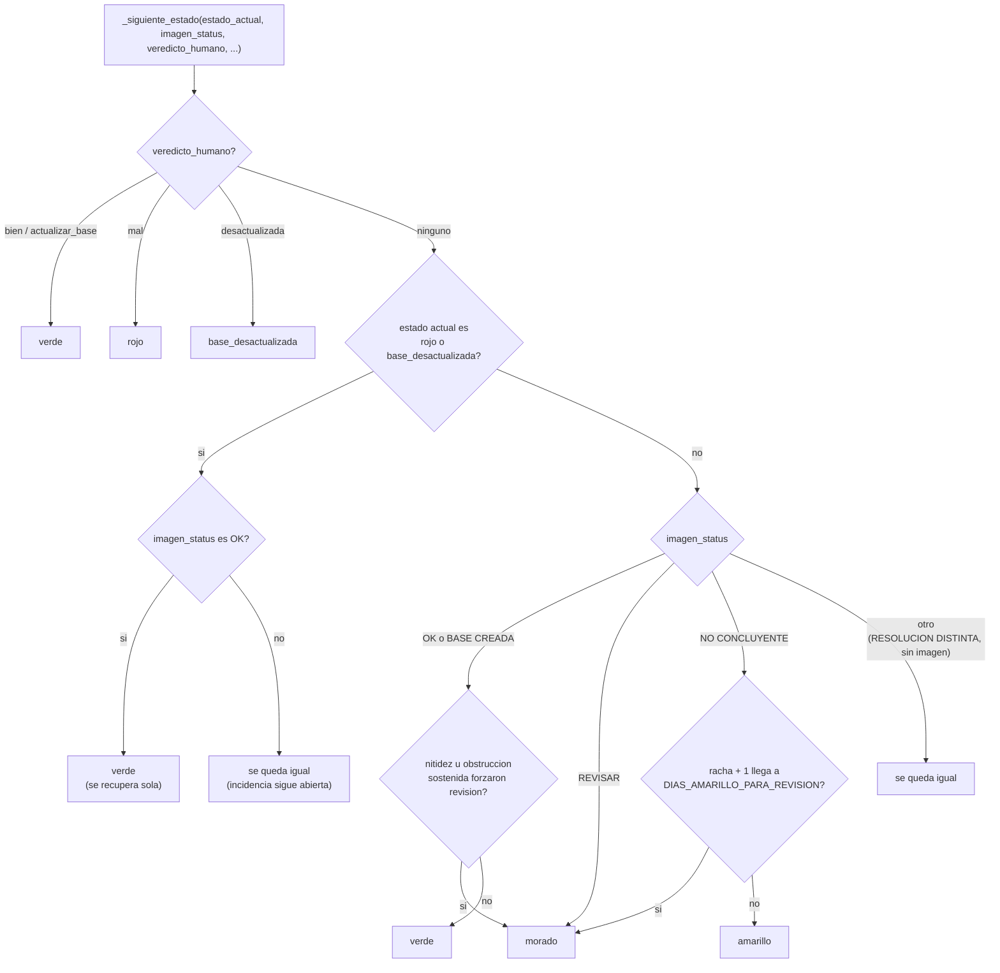
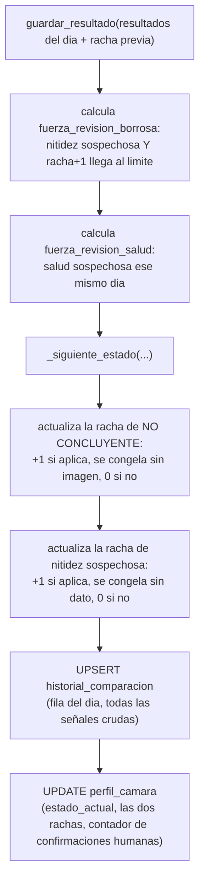

# Módulo: `persistencia/db.py`

> El motor de reglas: junta todas las señales que ya calcularon `comparacion/config_compare.py` y
> `comparacion/image_compare.py`, más el veredicto humano si lo hubo, y decide en qué color de
> semáforo queda cada cámara. También es el único módulo que toca PostgreSQL -- ningún otro módulo
> de este proyecto ejecuta SQL directamente.

## 1. Idea central

Dos tablas:

- **`perfil_camara`**: catálogo (identidad de la cámara) + **estado vivo** (el semáforo actual, y
  desde cuándo) + **perfil estadístico** (el umbral calibrado por cámara, ver
  `diagramas/02-modulo-comparacion-imagen.md`). Una fila por cámara, se actualiza en el lugar.
- **`historial_comparacion`**: el registro crudo, una fila por cámara por día (upsert: si ya existe
  una fila para esa cámara y fecha, se sobreescribe en vez de duplicar -- permite re-correr el
  mismo día sin ensuciar nada). Aquí quedan todos los números que calculó `image_compare.py`, para
  poder auditar o recalibrar después con datos reales.

`main.py` es quien decide **cuándo** llamar a cada función de este módulo -- este módulo no sabe
nada de cámaras físicas, archivos `.jpg`, ni de por qué un número salió como salió. Solo recibe
resultados ya calculados y decide qué hacer con ellos.

## 2. El semáforo: 5 estados posibles

| Estado | Significado | Pide revisión humana |
| --- | --- | --- |
| `verde` | Todo bien -- la comparación automática no encontró ningún problema. | No |
| `amarillo` | `NO CONCLUYENTE` reciente (menos de `DIAS_AMARILLO_PARA_REVISION` días seguidos) -- ningún método tiene confianza suficiente todavía, pero tampoco lleva tanto tiempo como para forzar que alguien lo vea. | No (todavía) |
| `morado` | Algo necesita que un humano decida: `REVISAR` directo, o una racha de `amarillo`/nitidez sospechosa que ya llegó a su límite de días, o una salud de imagen sospechosa (inmediata). | Sí |
| `rojo` | Incidencia **confirmada** por un humano (`"mal"`) -- queda abierta hasta que la comparación automática vuelva a dar `OK` sola (no se reabre la ventana mientras tanto). | No (ya se confirmó, solo se espera a que se resuelva sola) |
| `base_desactualizada` | Un humano confirmó que la base ya no sirve -- la cámara deja de compararse por completo hasta que alguien suba una base nueva (`ui/ventana_bases.py`) o use "Actualizar Base" en la propia ventana de revisión. | No (está congelada) |

> **Nota (26/10/2026)**: `base_desactualizada` se congela por dentro indefinidamente (como dice la
> tabla), pero no se queda sin presión para siempre -- `reporte/datos_reporte.py` la clasifica y
> colorea en el PDF con la misma urgencia que un `rojo` confirmado después de
> `DIAS_BASE_DESACTUALIZADA_URGENTE` (3) días sin resolver, con la etiqueta "Base de imágenes
> desactualizada (N días sin resolver)". Es **solo a nivel de reporte**: `estado_actual` en la base
> de datos nunca cambia a `rojo` de verdad -- si lo hiciera, la cámara desaparecería de la lista de
> `ui/ventana_bases.py` y `main.py` reanudaría comparaciones contra una base que todos ya
> acordaron que está mal. Ver `diagramas/05-modulo-reporte.md` (pendiente) para el detalle completo
> del reporte.

## 3. `_siguiente_estado()` -- la máquina de estados

**Orden de prioridad, de arriba hacia abajo** (el primero que aplica gana, los de abajo ni se
evalúan):

1. **El veredicto humano manda sobre todo lo demás** -- si alguien ya decidió, no importa qué
   diga la comparación automática ese mismo día.
2. **Una incidencia abierta (`rojo`/`base_desactualizada`) no se reabre sola** -- solo se cierra
   si la comparación automática vuelve a dar `OK`; cualquier otra cosa (`REVISAR`,
   `NO CONCLUYENTE`, etc.) no cambia nada mientras tanto. Así no se le vuelve a preguntar a un
   humano por un problema que ya confirmó, ni se reabre una base desactualizada por sí sola.
3. **`OK`/`BASE CREADA` casi siempre es verde** -- salvo que nitidez (sostenida) o salud
   (inmediata) hayan forzado que un humano lo vea de todas formas, aunque la geometría esté bien.
4. **`REVISAR` siempre es morado.**
5. **`NO CONCLUYENTE` escala a morado solo tras `DIAS_AMARILLO_PARA_REVISION` días seguidos** --
   antes de eso, se queda en ámbar sin molestar a nadie (pedido 22/10/2026: antes se quedaba en
   ámbar para siempre si nunca llegaba a confirmarse como movimiento real).
6. Cualquier otro caso (`RESOLUCION DISTINTA`, o un día sin imagen que comparar) **no cambia el
   estado** -- se queda exactamente como estaba el día anterior.

## 4. `guardar_resultado()` -- quien arma las banderas y llama a la máquina de estados

**"Se congela" en vez de "se reinicia a 0"** (pedido 22/10/2026, aplica a las dos rachas): un día
sin imagen que comparar (falla de conexión) o sin suficiente historial para evaluar nitidez no es
ni un "sí" ni un "no" -- así que la racha ni avanza ni se pierde. Antes de este cambio, una mala
suerte de conexión reiniciaba el conteo a 0, retrasando sin motivo real que se forzara la revisión.

## 5. El resto de funciones del módulo

| Función | Para qué sirve |
| --- | --- |
| `obtener_camara()` | Trae el perfil completo de una cámara (creándola con valores por defecto si es la primera vez que se ve). `main.py` la llama una vez por cámara, al principio de cada iteración. |
| `camaras_con_base_desactualizada()` | La lista que ve `ui/ventana_bases.py` -- todas las cámaras en ese estado. |
| `crear_observacion()` | Agrega una nota de texto libre ligada a una cámara (bitácora, no una fila por día). |
| `marcar_base_reemplazada()` / `limpiar_base_reemplazada()` | El par que trackea una promoción de base pendiente (ver `diagramas/02-modulo-comparacion-imagen.md`, punto 3): la primera se llama al reemplazar una base (a mano o con "Actualizar Base"), la segunda cuando `main.py` ya la promovió sola a mediana. |
| `recalcular_perfiles_estadisticos()` | Recalibra el umbral de movimiento por cámara (ver `diagramas/02-modulo-comparacion-imagen.md`, la conexión de `umbral_para()`). Se corre una vez al final de cada corrida, nunca a mitad -- para no calibrar con datos del día que todavía no se terminaron de verificar ese mismo día. |

## 6. Lo que este módulo NO hace

- No decide cuándo llamarse a sí mismo -- `main.py` es quien orquesta el orden (traer el perfil,
  comparar, pedir revisión si hace falta, guardar el resultado).
- No sabe nada de archivos `.jpg`, rutas, ni de cómo se calculó ningún número -- solo recibe los
  resultados ya armados por `comparacion/image_compare.py` y `comparacion/config_compare.py`.
- No decide el texto del diagnóstico que ve el humano -- eso lo arma `main.py`
  (`_formatear_diagnostico`).
- No es el único lugar donde se actualiza `perfil_camara` -- `marcar_base_reemplazada()`,
  `limpiar_base_reemplazada()` y `recalcular_perfiles_estadisticos()` también escriben ahí, cada
  una en su propio momento, fuera del flujo normal de `guardar_resultado()`.
