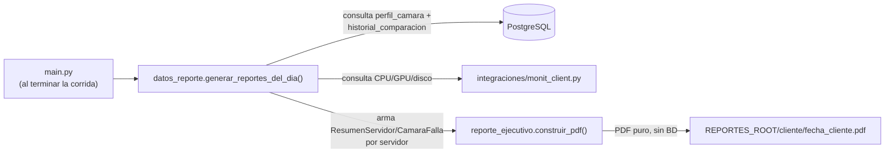
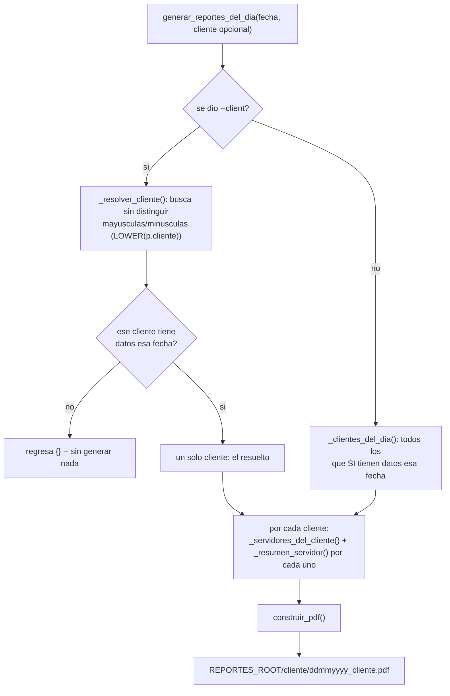
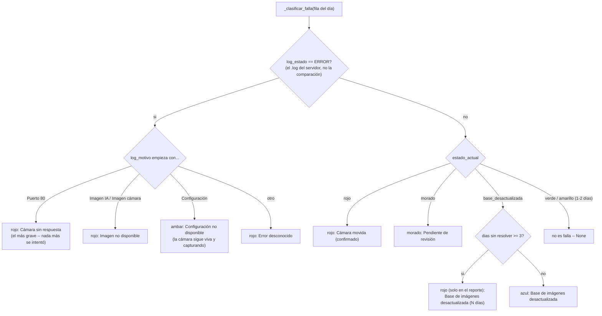
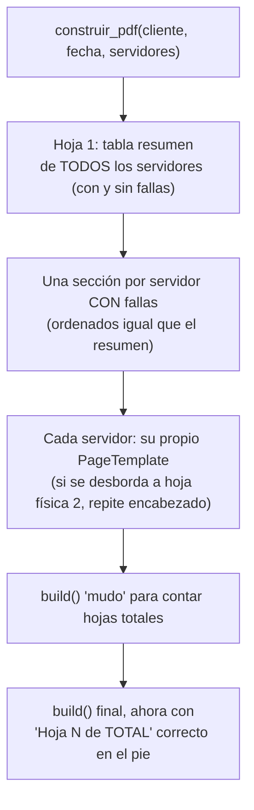

# Módulo: `reporte/` (`datos_reporte.py` + `reporte_ejecutivo.py`)

> El último eslabón de la corrida diaria: convierte lo que ya quedó en PostgreSQL (y lo que reporta
> Monit_Servers_V2) en un PDF por cliente. Dos archivos con una separación de responsabilidad
> estricta -- `datos_reporte.py` es el único que toca la base de datos; `reporte_ejecutivo.py` es un
> módulo puro que solo sabe construir un PDF a partir de datos ya resueltos (`ResumenServidor`), sin
> saber qué es PostgreSQL ni Monit_Servers_V2. Por eso existe `scripts/mock_reporte_ejecutivo.py`:
> puede generar un PDF de muestra con datos inventados sin tocar nada real.

## 1. Idea central



`datos_reporte.py` arma, por cada servidor con datos ese día, un `ResumenServidor` (conteos +
métricas) con su lista de `CamaraFalla` (una por cámara que no está simplemente "verde y sin
falla"). `reporte_ejecutivo.py` recibe esa lista ya resuelta y solo decide cómo dibujarla.

## 2. `generar_reportes_del_dia()` -- un PDF por cliente



Dos bugs reales ya corregidos que vale la pena recordar (porque el mismo patrón puede repetirse en
otro lado del proyecto):

- **`--client ABINBEV` generaba un PDF vacío** en vez de encontrar `AbInBev` (22/10/2026) --
  Postgres distingue mayúsculas, `_resolver_cliente()` compara con `LOWER()` en ambos lados.
  **Exactamente el mismo tipo de bug** que encontramos el 28/10/2026 en `scripts/revisar_bases.py`
  (`AbINBEV` creaba una cámara fantasma) -- aquí ya estaba resuelto desde antes, con el mismo
  enfoque (normalizar antes de usar), solo que a nivel de consulta SQL en vez de validar contra una
  lista de combinaciones reales.
- **Sin `cliente`, generaba y enviaba el reporte de OTRO cliente** que ya tuviera datos ese mismo
  día (21/10/2026) -- `--client AbInBev` corrido después de que `Api_Manzanillo` ya se procesó ese
  día terminaba reenviando el correo de `Api_Manzanillo` también, porque la función no filtraba por
  cliente en ningún punto. Ahora `cliente` acota TODO el proceso, no solo qué cámaras comparó
  `main.py`.

## 3. `_clasificar_falla()` -- qué cuenta como falla y cómo se ve



Puntos importantes de esta función:

- **`log_estado == ERROR` se revisa primero y gana sobre todo lo demás** -- si el `.log` del
  servidor dice que la cámara no respondió ese día, no importa qué diga `estado_actual` (que de
  todas formas no cambió ese día, ver `db._siguiente_estado`: sin imagen que comparar, el estado se
  congela). Esas filas no traen imágenes (`ruta_base`/`ruta_actual` quedan `None`) -- no hay "actual"
  que capturar.
- **`amarillo` casi nunca llega aquí.** Un `NO CONCLUYENTE` de 1-2 días es ámbar pero *no* cuenta
  como falla (`_resumen_servidor` lo suma aparte, en su propia columna); al 3er día seguido,
  `db._siguiente_estado()` ya lo convirtió en `morado` antes de que esta función lo vea. El único
  ámbar que sí llega aquí es el de "Configuración no disponible" (un problema de conexión, no de
  comparación).
- **`base_desactualizada` escala a "rojo" en el PDF después de 3 días sin resolver, sin tocar la
  base de datos** -- `estado_actual` sigue literalmente `base_desactualizada` (si cambiara a
  `rojo` de verdad, la cámara desaparecería de la lista de `ui/ventana_bases.py`). Es pura
  cosmética de urgencia en el reporte, calculada con `fecha - estado_desde`.

## 4. `_resumen_servidor()` -- los conteos que cierran siempre

```sql
SELECT p.camara, p.estado_actual, p.dias_no_concluyente_consecutivos, p.estado_desde,
       h.imagen_motivo, h.log_estado, h.log_motivo
FROM historial_comparacion h JOIN perfil_camara p ON p.id = h.camara_id
WHERE p.cliente = %s AND p.planta = %s AND p.servidor = %s AND h.fecha = %s
```

`camaras_totales` = todas las filas de ese servidor ese día. La suma de `camaras_ok`,
`camaras_no_concluyentes` y `len(fallas)` debe dar exactamente ese total -- por eso
`base_desactualizada` se agregó a `_clasificar_falla()` (antes "desaparecía" del conteo, pedido
22/10/2026) y por eso el ámbar de 1-2 días se cuenta aparte en vez de perderse.

## 5. `reporte_ejecutivo.py` -- construcción del PDF (módulo puro)



- **Por qué se construye el PDF 2 veces**: el pie necesita "Hoja N de TOTAL", pero ReportLab no sabe
  cuántas hojas hacen falta hasta que termina de fluir el contenido (una tabla de fallas larga se
  puede desbordar a una segunda hoja física). Primer `build()` solo para contar, segundo para el
  archivo real.
- **Orden de servidores**: por nombre, no por planta (pedido 21/10/2026) -- con un caso especial
  para AbInBev, cuyos servidores mezclan dos prefijos (`QLYMSPROD`/`QBYMSPROD`) que ordenan mal
  alfabéticamente; se ordena por los dígitos finales en su lugar. El mismo orden se usa en la tabla
  resumen y en las hojas de detalle (antes solo coincidía en una de las dos, bug real 22/10/2026).
- **Imágenes dañadas no tumban el PDF** -- `_abrir_imagen_segura()` (compartida con
  `ui/ventana_revision.py`) regresa `None` en vez de reventar; esa cámara muestra el texto "Imagen no
  disponible (archivo dañado)" en su lugar.
- **La cuadrícula de ayuda es la misma que la ventana de revisión** (`_con_cuadricula()`,
  reutilizada tal cual) -- mismo criterio visual para juzgar movimiento en el PDF que en la revisión
  en vivo.

## 6. Lo que este módulo NO hace hoy (encontrado en esta revisión, 28/10/2026)

Ninguno de estos tres es un bug -- son huecos conocidos, confirmados leyendo el código línea por
línea, todos con la misma causa: `_clasificar_falla()`/`_resumen_servidor()` solo miran
`estado_actual` (el semáforo de **imagen**) y `log_estado`. Nada más entra al PDF.

| Señal que existe en la base de datos | Por qué no sale en el PDF |
| --- | --- |
| `perfil_camara.config_estado_actual = 'incidencia'` (28/10/2026) | `_resumen_servidor()` ni siquiera selecciona esta columna en su `SELECT`. Una cámara con una incidencia de configuración abierta (alguien marcó "Mal" en `pedir_revision_config()`) se sigue contando como "OK" en el resumen si su imagen está bien. |
| `historial_comparacion.config_status = 'CAMBIO'` / `config_veredicto_humano` | Mismo caso -- cero menciones a estas columnas en todo `reporte/`. |
| `servicio_ia` / `historial_servicio_ia` (27/10/2026, salud del servicio de IA) | Tablas completamente nuevas, nunca consultadas aquí. Dos servicios llevan caídos varios días (`Pemex/DEMOQUA`, `C5i_Colima/COLIMA01`) sin que nadie lo vea en un PDF. |
| `imagen_status = 'RESOLUCION DISTINTA'` | No es uno de los estados que `_clasificar_falla()` reconoce (`rojo`/`morado`/`base_desactualizada`) -- y tampoco cambia `estado_actual` (`db._siguiente_estado()` la deja "igual que estaba"), así que ni siquiera hay una señal persistente que el reporte pudiera consultar. Visto un caso real el 28/10 (`AD1r1`), invisible hasta que se consultó la base de datos directo. |

Estos 4 huecos son, en orden, lo que ya se había acordado tratar junto con esta revisión (servicio
de IA Fase 2, configuración) más uno nuevo que salió de leer el código con cuidado (`RESOLUCION
DISTINTA`). Pendiente de diseñar la tabla de reglas -- se retoma después de esta revisión.

## 7. El resto de funciones del módulo

| Función | Para qué sirve |
| --- | --- |
| `_rutas_imagenes()` | `(ruta_base, ruta_actual)` para el PDF -- usa `image_compare.base_path()` (la foto real de un solo día, nunca la mediana, ver `diagramas/02-modulo-comparacion-imagen.md`), `None` si el archivo no existe en vez de detener el reporte. |
| `_etiqueta_sin_respuesta()` | Traduce el `log_motivo` crudo a una etiqueta + color según qué tan grave es el paso que falló (puerto > imagen > configuración). |
| `_clientes_del_dia()` / `_servidores_del_cliente()` | Listas de distinct, acotadas a la fecha (y opcionalmente al cliente) que se está reportando. |
| `_tabla_resumen_servidores()` / `_tabla_fallas_servidor()` | Las 2 tablas de ReportLab (hoja 1 y hojas de detalle). |
| `_imagen_proporcional()` | Cada imagen mantiene su proporción real (ancho/alto del archivo), nunca un ratio fijo a ojo. |

## 8. Lo que este módulo NO hace (estructura, no datos)

- `reporte_ejecutivo.py` no sabe nada de PostgreSQL, `Monit_Servers_V2`, ni de cómo se calculó
  ningún número -- recibe `ResumenServidor`/`CamaraFalla` ya armados. Por eso
  `scripts/mock_reporte_ejecutivo.py` puede generarle datos inventados sin tocar nada real.
- `datos_reporte.py` no decide cuándo correrse -- lo llama `main.py` (o `generar_reporte.py`,
  `scripts/backfill_reportes.py` en su propia simulación en memoria) al terminar la corrida del día.
- No envía correos -- eso es `integraciones/correo.py`, que recibe el diccionario
  `{cliente: ruta}` que regresa `generar_reportes_del_dia()`.
